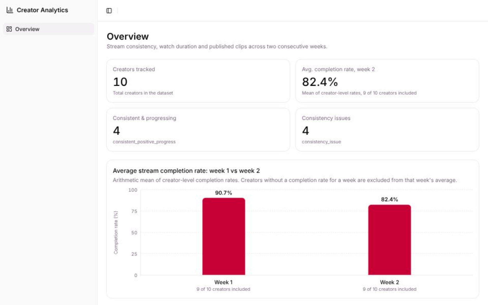

# Creator Analytics

A small performance dashboard that helps an operations team see **how consistently creators stream and how long viewers stay**, not just how many people watched. It compares two consecutive weeks for 10 representative creators and generates short, evidence-based assessments with a concrete next action.

**Live demo:** https://creator-analytics-pi.vercel.app/



## The problem

A creator with many followers may stream irregularly, while a smaller creator may stream reliably and keep viewers engaged. Total views hide this. The dashboard makes three things visible per creator and per week:

- **Consistency**: planned vs. completed streams (completion rate)
- **Engagement**: average watch duration
- **Clip output**: published short clips

It then turns the numbers into one of three assessments, each with the data it relies on and a recommended next step.

## What the dashboard shows

- **Summary cards**: creators tracked, average week 2 completion rate, and the number of creators in each of the two main assessment categories.
- **Weekly comparison chart**: average completion rate for week 1 vs. week 2, with how many creators are included in each average.
- **Creator table**: week 2 values and week-over-week changes (completion in percentage points, watch duration in minutes, clips) plus the assessment badge. An em dash (`—`) always means "data unavailable", never zero.
- **Assessment details**: a dialog per creator with itemized evidence and the recommended next action.

## How assessments are generated

Assessments come from **explicit, deterministic rules. No AI or LLM is involved at runtime.** The rules live in [`app/lib/assessment.ts`](app/lib/assessment.ts) and follow [`docs/ASSESSMENT_RULES.md`](docs/ASSESSMENT_RULES.md). They are evaluated in this order:

| Order | Category | Condition |
|---|---|---|
| 1 | `insufficient_data` | A week has no planned streams, so the completion rate cannot be calculated for one or both weeks. |
| 2 | `consistency_issue` | Week 2 completion rate is below **75%**, or it dropped by **25 percentage points or more**. |
| 3 | `consistent_positive_progress` | No consistency issue, and at least one indicator improved: completion rate, average watch duration, or published clips. |

Missing data is handled **per metric**. A missing watch duration or clip total does not turn an otherwise assessable creator into `insufficient_data`; that change is simply reported as "could not be calculated". Consistency and engagement are interpreted separately, so an engagement gain never hides a consistency problem (and vice versa).

Every assessment contains the category, itemized evidence built from the calculated values (including planned/completed counts, not only percentages), and a next action. Example for a creator with a consistency issue:

> - Week 1: 4/4 streams (100%).
> - Week 2: 2/4 streams (50%).
> - Completion rate dropped 50 percentage points.
> - Week 2 completion rate is below the 75% threshold.
> - Average watch duration 16 min → 12.5 min (-3.5 min). This is a signal to monitor.
>
> **Next action:** Discuss the missed streams with the creator and agree on an achievable streaming plan for next week.

The text states what the data shows and never asserts a cause the data cannot establish. Thresholds are prototype assumptions, not industry standards.

## Calculation rules

All calculations are pure TypeScript functions in [`app/lib/analytics.ts`](app/lib/analytics.ts), kept outside React components.

- **Completion rate** = completed streams / planned streams × 100. It is `null` when planned streams is 0.
- **Weekly change** = week 2 value − week 1 value. Completion-rate changes are in percentage points (50% → 75% is +25 pp). If either week is unavailable, the change is `null`.
- **Average watch duration** = simple arithmetic mean over completed streams that have a valid measurement. Missed streams and `null` measurements are excluded; if none remain, the value is `null`.
- **Published clips** = sum of clips for the week's streams. If any stream has `publishedClips: null`, the weekly total is `null`; a week with no stream records also yields `null`.
- **`null` is never treated as `0`.** A real zero stays distinguishable from missing data throughout the UI.

## Mock data

[`app/data/streams.json`](app/data/streams.json) holds **61 stream records** for **10 creators** ([`creators.json`](app/data/creators.json)). The raw data is stream-level: one record per planned stream (`completed` or `missed`). Weekly summaries are calculated from these records and are not stored.

The dataset is designed to exercise every category and the edge cases:

| Creators | Weeks 1 → 2 (completed/planned) | Expected category | Case covered |
|---|---|---|---|
| 001 Elif Kaya | 3/4 → 4/4 | Consistent & progressing | All indicators improve |
| 002 Mert Aydın | 4/4 → 4/4 | Consistent & progressing | Watch duration up; one clip count missing, so week 2 clip total is `null` |
| 003 Deniz Yılmaz | 3/3 → 3/3 | Consistent & progressing | Clips up while watch duration drops (shown, not hidden) |
| 004 Selin Arslan | 2/3 → 3/3 | Consistent & progressing | Week 2 watch duration unavailable |
| 005 Can Demir | 4/4 → 2/4 | Consistency issue | Below 75% and a 50 pp drop |
| 006 Ayşe Koç | 4/4 → 3/4 | Consistency issue | Boundary: exactly −25 pp, week 2 exactly 75% |
| 007 Burak Şahin | 3/4 → 2/3 | Consistency issue | Below 75% with a small drop |
| 008 Zeynep Çelik | 2/2 → 1/2 | Consistency issue | Small sample, counts shown next to percentages |
| 009 Emre Polat | no streams → 3/3 | Insufficient data | Week 1 has no planned streams |
| 010 Ceren Öztürk | 3/3 → no streams | Insufficient data | Week 2 has no planned streams |

## Architecture

```
app/data/*.json            raw stream-level mock data
  └─ app/lib/analytics.ts   weekly metrics and week-over-week changes
      └─ app/lib/assessment.ts   rule-based assessments (category, evidence, next action)
          └─ app/lib/overview.ts   dashboard summary object
              └─ app/routes/home.tsx   route loader → app/components/overview/*   presentation only
```

There is no backend. The route `loader` plays the role of the weekly analysis endpoint described in [`docs/API_DESIGN.md`](docs/API_DESIGN.md), so it can later be replaced by a real API without touching the UI.

## Assumptions and limitations

- **Week boundaries are not defined in the case notes.** I assumed Monday–Sunday in the `+03:00` timezone: week 1 is 5–11 Oct 2026 and week 2 is 12–18 Oct 2026 (`WEEK_1_START` in `analytics.ts`).
- **Averages are unweighted.** Weekly watch duration is the mean of per-stream averages, and the dashboard-level completion rate is the mean of creator-level rates. Neither is weighted by viewers or stream counts.
- **Thresholds are prototype assumptions** (75% and 25 pp) and should be validated with product stakeholders. There is no fixed watch-duration or clip-count target, so only changes are reported.
- **Two weeks are only a short window.** Results are signals about the observed period, not proof of long-term behavior.
- **One case fits none of the three categories.** A creator with sufficient data, no consistency issue and no improving indicator is shown as "Not categorized" instead of being forced into a label. No mock creator falls into it.
- **No automated test suite is included.** Calculations and rules were checked with type checking, a production build, one-off scripts covering boundary and missing-data cases, and browser checks of the layout and dialog.
- The comparison chart is drawn with plain HTML/CSS to avoid adding a chart dependency for two bars.

## Getting started

Requires Node.js and [pnpm](https://pnpm.io/).

```bash
pnpm install
pnpm dev        # http://localhost:5173
pnpm typecheck  # route types + tsc
pnpm build      # production build
pnpm start      # serve the production build
```

## Short demo walkthrough

1. Open the [live demo](https://creator-analytics-pi.vercel.app/) and read the four summary cards. The average completion rate states that 9 of 10 creators are included.
2. Check the chart: week 1 vs. week 2 averages, each with its included-creator count.
3. In the table, compare Can Demir (completion dropped) with Elif Kaya (completion improved), and note the em dashes for unavailable values (for example Mert Aydın's week 2 clips).
4. Click **View details** on any creator to read the evidence and the recommended next action.
5. Look at Emre Polat or Ceren Öztürk to see how missing data leads to `insufficient_data` instead of a made-up result.

## Further reading

- [`docs/API_DESIGN.md`](docs/API_DESIGN.md): data flow and the weekly analysis layer
- [`docs/STREAM_DATA_MODEL.md`](docs/STREAM_DATA_MODEL.md): stream record model and metric rules
- [`docs/ASSESSMENT_RULES.md`](docs/ASSESSMENT_RULES.md): categories, thresholds and evidence requirements

## Tech stack

React 19, React Router 8 (SSR), TypeScript, Vite, Tailwind CSS v4 and shadcn/ui (Base UI).
